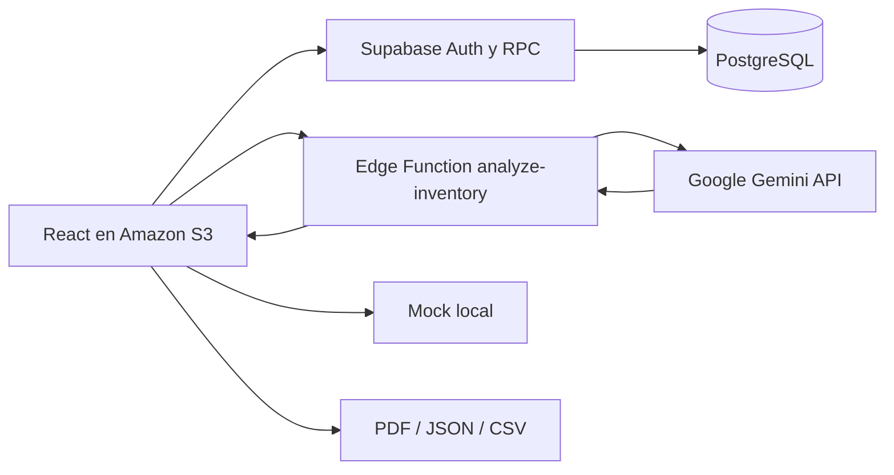
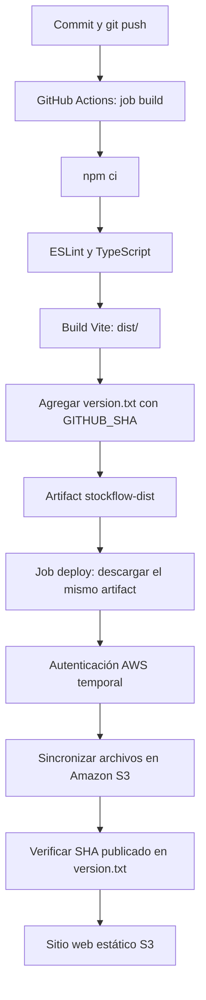

# StockFlow | AI Integration & Cloud Deployment

StockFlow es una aplicación web para la gestión de inventarios, productos, usuarios y movimientos de entrada y salida. Este proyecto amplía la aplicación React del módulo anterior mediante la integración de Google Gemini, la generación de informes y la automatización de la compilación y publicación en Amazon S3.

- **Repositorio:** https://github.com/JenniferPita/FS-Bootcamp
- **Rama del proyecto:** `feature/ai-cloud`
- **Sitio S3 (endpoint esperado; confirmar en AWS):** http://stockflow-react-564934668615-us-east-1-an.s3-website-us-east-1.amazonaws.com
- **Versión funcional:** V2.0

## 1. Instalación

### Requisitos

- Git.
- Node.js 24 LTS y npm (entorno utilizado: Node.js 24.18.0 y npm 11.16.0).
- Proyecto Supabase activo y configurado con el esquema, políticas y funciones RPC de StockFlow.

### Ejecutar en local

```bash
git clone https://github.com/JenniferPita/FS-Bootcamp.git
cd FS-Bootcamp
git switch feature/ai-cloud
cd app
npm ci
```

Crear `app/.env` desde la raíz del repositorio (o `.env` desde `app/`) con la configuración pública descrita en la siguiente sección. Después, desde `app/`:

```bash
npm run dev
```

Abrir http://127.0.0.1:5173 e iniciar sesión con una cuenta de prueba autorizada. El módulo **Análisis IA** se encuentra en el menú lateral de la aplicación.

### Validación y build de producción

Desde `app/`:

```bash
npm run lint
npm run check
npm run build
```

ESLint comprueba el código; TypeScript verifica los tipos; Vite genera el build y el script de copia incorpora los recursos estáticos de las páginas originales. El resultado se encuentra en `dist/`, en la raíz del repositorio (no en `app/dist/`). Esta carpeta contiene exclusivamente los recursos del frontend y no incluye el backend ni las credenciales privadas.

## 2. Configuración pública

El cliente Supabase utiliza las siguientes variables de entorno de Vite:

```dotenv
VITE_SUPABASE_URL=https://fnuoiwjbcolwkpkoigct.supabase.co
VITE_SUPABASE_PUBLISHABLE_KEY=REEMPLAZAR_CON_CLAVE_PUBLICABLE
```

La clave publicable se obtiene desde el panel del proyecto Supabase. No utilizar una clave `service_role` ni una clave secreta en el frontend. El archivo `app/.env` está excluido de Git. Las variables `VITE_*` se incorporan al build y son visibles para el navegador; la seguridad de los datos depende de la autenticación y los controles de acceso del backend.

### Configuración del servicio de IA y del despliegue

La función `analyze-inventory` se despliega en Supabase Edge Functions. El modelo se selecciona mediante configuración del servidor. La clave de Google AI Studio se configura exclusivamente como secreto de Supabase; no se incluye en el código, en el frontend ni en S3.

| Variable | Ubicación | Propósito |
| --- | --- | --- |
| `GEMINI_API_KEY` | Supabase Secrets | Credencial privada del proveedor IA |
| `GEMINI_MODEL` | Supabase Secrets | Modelo principal de Gemini |
| `GEMINI_FALLBACK_MODEL` | Supabase Secrets (opcional) | Modelo alternativo para el último reintento |
| `VITE_SUPABASE_URL` | GitHub Actions Secrets | URL pública para el build |
| `VITE_SUPABASE_PUBLISHABLE_KEY` | GitHub Actions Secrets | Clave publicable para el build |
| `AWS_ACCESS_KEY_ID`, `AWS_SECRET_ACCESS_KEY`, `AWS_SESSION_TOKEN` | GitHub Actions Secrets | Credenciales temporales de AWS Academy |

El workflow utiliza la región `us-east-1` y el bucket `stockflow-react-564934668615-us-east-1-an`. No se publican valores de credenciales privadas en esta documentación.

El modo **Análisis simulado (mock)** genera recomendaciones mediante reglas locales a partir del inventario consultado en Supabase. No requiere una clave de Gemini, aunque sí una sesión válida y acceso al inventario. Los modos de fallo y respuesta inválida permiten comprobar la gestión de errores.

## 3. Arquitectura

### Componentes y responsabilidades

| Componente | Tecnología y responsabilidad |
| --- | --- |
| Frontend | React, TypeScript, Vite y Mantine; interfaz, navegación, indicadores y gestión de estados |
| Backend / API | Supabase: autenticación, base de datos PostgreSQL, RPC y Edge Functions |
| Proveedor IA | Google Gemini API, consultado desde `analyze-inventory` |
| Validación | Zod en el servicio de análisis y en la Edge Function |
| Simulador | Mock local basado en reglas de stock, identificado explícitamente en la interfaz |
| Informes | jsPDF para PDF; exportación JSON y CSV desde el navegador |
| CI/CD | GitHub Actions; validación, compilación, artifact y publicación automática |
| Hosting | Amazon S3, sitio web estático |
| CDN | CloudFront sería una capa opcional para HTTPS, caché y distribución; no se acredita su implementación en este proyecto |



### Flujo del análisis de inventario

1. El usuario autenticado inicia el análisis; React consulta `get_dashboard_products` y utiliza los productos activos.
2. El servicio valida las entradas antes de enviar los datos necesarios a la Edge Function.
3. La función verifica la sesión y que el perfil del usuario esté activo, valida la entrada y consulta Gemini usando la clave almacenada en el servidor.
4. Gemini devuelve un resumen, nivel de riesgo y recomendaciones en JSON. Se valida la respuesta antes de mostrarla. Los indicadores de productos activos, agotados y con stock bajo se calculan a partir de los datos de inventario.
5. La interfaz presenta estados inicial, carga, éxito y error, con posibilidad de reintentar. Ante errores temporales de Gemini, el backend realiza hasta tres intentos con esperas de 2 y 4 segundos. El modo mock se selecciona explícitamente si el proveedor no está disponible.
6. En V2.0 el usuario puede descargar el resultado en PDF, JSON o CSV, con fecha y hora del análisis (zona `America/Guayaquil`), sin realizar otra consulta a Gemini.

### Flujo de integración y despliegue continuo



El archivo `.github/workflows/ci.yml` ejecuta CI en los pushes a `main` y `feature/ai-cloud`, en pull requests hacia `main` y mediante ejecución manual. El job de despliegue se ejecuta únicamente en pushes a `feature/ai-cloud` después de un build exitoso. El artifact `stockflow-dist` tiene una retención configurada de 30 días.

El despliegue descarga el artifact del mismo workflow, verifica su commit, sincroniza los archivos con S3 y publica `version.txt` con el SHA completo. Luego comprueba que el identificador leído desde S3 coincide con `GITHUB_SHA`. Esto permite demostrar la trazabilidad **commit → CI → build → artifact → publicación**. La Edge Function se despliega por separado desde Supabase, no como parte del workflow de S3.

### Registro de versiones publicadas

| Aspecto | V1 | V2.0 |
| --- | --- | --- |
| Commit de publicación | [`2757da5`](https://github.com/JenniferPita/FS-Bootcamp/commit/2757da5) | [`4714a96`](https://github.com/JenniferPita/FS-Bootcamp/commit/4714a96) |
| Gemini, mock y validaciones | Sí | Sí |
| Gestión de errores | Sí | Sí |
| CI/CD automático a S3 | Sí | Sí |
| Fecha y hora del análisis | No | Sí |
| Exportación PDF, JSON y CSV | No | Sí |
| Reintentos automáticos de Gemini | No | Sí |
| Modelo alternativo configurable | No | Sí (opcional) |

Ambas publicaciones fueron reportadas como exitosas. La ejecución CI #17, commit `9388dac`, generó un artifact antes de configurar el despliegue continuo; no corresponde al commit oficial de publicación V1.

El commit funcional de V2.0 es `4714a96` (V2: Agrega exportacion PDF, JSON, CSV y reintentos de Gemini). El despliegue fue reportado como exitoso tras renovar las credenciales de AWS Academy. Para verificar la trazabilidad, contrastar el SHA del workflow correspondiente con `/version.txt` y conservar las capturas de ambas versiones. Un commit posterior exclusivamente de documentación puede actualizar `version.txt` mediante CI/CD sin cambiar la versión funcional V2.0. El enlace exacto de la ejecución CI/CD de V2 queda pendiente de incorporar.

### Evidencias de entrega

- Captura del CI exitoso y del artifact de build.
- Captura del bucket y de la configuración Static website hosting.
- Captura del análisis exitoso con Gemini y del error controlado.
- Capturas de la interfaz V1 y V2, con el SHA publicado de cada versión.
- Informe PDF generado desde V2 y, como respaldo, archivos JSON y CSV.

## 4. Limitaciones

- **Hosting HTTP:** el endpoint de sitio web estático de S3 no ofrece HTTPS nativo. CloudFront u otra capa HTTPS sería necesaria para usar credenciales reales de forma segura. Para la demostración utilizar únicamente datos y cuentas de prueba; no introducir credenciales reales en un sitio HTTP.
- **Navegación SPA:** React utiliza BrowserRouter con base `/app`. El hosting estático puede devolver un error al recargar o acceder directamente a rutas internas si no se configura un mecanismo de redirección o fallback adecuado.
- **AWS Academy:** las credenciales de Learner Lab son temporales. Durante la publicación V2 expiró el token de sesión; se actualizaron los tres Secrets de AWS y se volvió a ejecutar el despliegue exitosamente. El CD depende de una sesión y permisos vigentes.
- **Disponibilidad de Gemini:** se observaron respuestas HTTP 503 del proveedor, comunicadas inicialmente como 502 por la Edge Function. Se incorporaron reintentos limitados. El servicio real funcionó en pruebas, pero su disponibilidad sigue siendo intermitente. El modo mock permanece disponible y claramente identificado; no genera respuestas mediante un modelo de IA.
- **Supabase Free:** el proyecto se pausó durante el desarrollo y fue necesario reactivarlo desde el panel para recuperar la autenticación y el acceso a los datos.
- **Alcance del análisis:** máximo de 200 productos por solicitud en la Edge Function. Las recomendaciones se basan en las existencias actuales; no constituyen pronósticos de demanda ni órdenes automáticas de compra. Deben ser revisadas por el usuario.
- **Seguridad y costos:** solo deben enviarse a Gemini datos de prueba no confidenciales. No se implementó un limitador de solicitudes por usuario. Los límites y disponibilidad del proveedor dependen de la cuenta y del modelo configurado.
- **Compilación:** Vite emitió advertencias por scripts HTML tradicionales y tamaño de chunks; no impidieron el build. El despliegue sincroniza archivos sin `--delete`, por lo que pueden permanecer recursos antiguos en el bucket.
- **Automatización:** el CI/CD publica únicamente el frontend. Las migraciones y las Edge Functions de Supabase se administran por separado. No se ha acreditado una CDN ni una suite de pruebas automatizadas adicional a las validaciones de ESLint, TypeScript y build.
